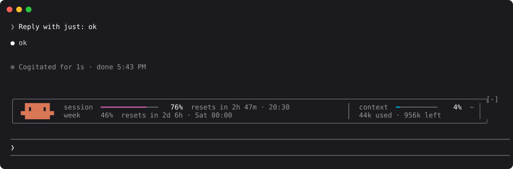
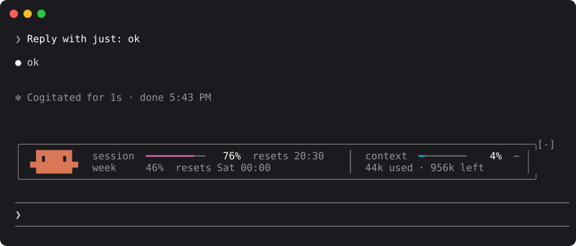
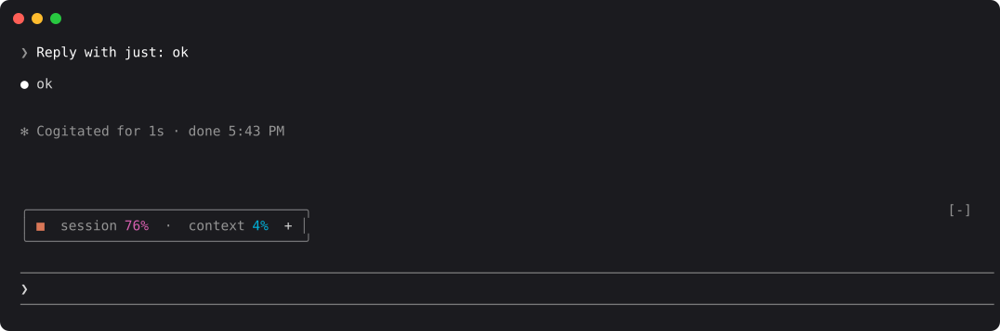

# session-usage

**Know how much of your Claude plan is left, without asking.**

A Claude Code mod that keeps a quiet panel above the prompt: how much of your 5-hour session and your week you've used, when each one resets, and how full the context window is. Clawd keeps you company on the left, and he blinks.



## What it shows

| | |
|---|---|
| **session** | Your 5-hour usage window: a bar, the percentage, the time left, and the clock time it resets (`resets in 2h 47m · 20:30`). If the reset isn't today, it says `tomorrow` or the weekday. |
| **week** | Your 7-day window, as one gray line with no bar. It's there when you look and quiet when you don't. |
| **context** | How full the context window is: a bar, the percentage, and the tokens used and left (`44k used · 956k left`). |
| **Clawd** | Claude Code's mascot, in Claude orange. He blinks every 6 to 15 seconds, at random, and sometimes twice in a row. |

The figures are real, not estimates. At launch the panel asks the same plan-usage endpoint the `/usage` command reads, so it has numbers before you type anything. After that, Claude Code updates them after each reply.

### Colors

The bars are colored like a day running out, so nothing looks wrong until something is:

| Used | Color | |
|---|---|---|
| under 50% | cyan | morning |
| 50% to 74% | blue | afternoon |
| 75% to 89% | magenta | dusk |
| 90% and up | red | last light |

Everything else stays gray. Only the filled part of each bar and the percentages are drawn in full color.

### It fits the terminal you have

As the terminal narrows, the panel gives things up in order: the bars get shorter, then the reset text keeps only the clock time, and only then does the context column step aside.



### Minimize it

Press `−` at the panel's right edge to fold it into a small card, and `+` to open it again. The card shows only the two percentages, in their colors. Your choice is remembered across sessions.



The buttons respond to a click in the fullscreen terminal, or from the keyboard: `ctrl+x tab` focuses the panel, then `enter`.

### A little breathing room

The mod also adds one blank row above the `✻ Worked for 2m 4s` line that ends each turn, so it doesn't sit tight against the reply.

## Install

In a Claude Code terminal session:

```
/plugin install session-usage --marketplace joaofatoretto/session-usage
```

Answer `y` to add the marketplace, then choose the **user** scope so the panel appears in every session.

Or from the command line:

```bash
claude plugin marketplace add joaofatoretto/session-usage
claude plugin install session-usage@session-usage --scope user
```

To try it for a single session without installing it:

```bash
git clone https://github.com/joaofatoretto/session-usage.git
claude --plugin-dir ./session-usage
```

**Requirements**

- Claude Code with mods (function-hook plugins). Built and tested on **2.1.293**.
- A terminal. The panel is drawn in the band above the prompt, on the terminal and desktop surfaces. It was tested in the terminal.
- A Claude subscription login (Pro or Max) for the session and weekly figures. With an API key there are no plan limits to show, so the panel shows the session's cost instead.

## How it works

The mod is one hooks module, [`hooks/register.tsx`](hooks/register.tsx).

| Hook | What it does |
|---|---|
| `session.start` | Reads `$.session.usage()`. If no reply has reported the limits yet, it asks the plan-usage endpoint (see below). Loads your minimized choice, and starts Clawd's blink timer and a once-a-minute tick for the countdown. |
| `session.measure` | Claude Code raises this after each turn, and whenever a limit moves by a whole point. The panel stores the new figures and redraws. |
| `ui.render` on `AbovePrompt` | Draws the panel or the minimized card. It measures its own lines and picks the widest layout that fits `bodyColumns`. |
| `ui.render` on `TurnDuration` | Draws Claude Code's own turn-duration line, one row lower. |

**Sharing the band.** Only one mod can draw above the prompt at a time. Before drawing, the panel asks the mods beneath it. If one of them has something to show, such as a confirmation from a safety mod, the panel gives up the band until that's done.

### Privacy

- **One network request, at launch,** and only when Claude Code has no figures yet: a `GET` to `https://api.anthropic.com/api/oauth/usage`. It goes through `$.session.authorize()` and `$.http.fetch`, so Claude Code attaches your login itself, only for Anthropic's own host. The mod never sees the credential.
- **One stored value:** whether the panel is minimized, in the mod's own plugin store.
- Nothing else leaves your machine or is written anywhere.

## Limitations

- **It sits above the prompt, not at the top of the window.** Claude Code gives mods no place pinned to the top of the screen.
- **The figures refresh when you send a message here.** Usage from another Claude window or device shows up after your next reply in this one.
- **The plan-usage endpoint isn't a documented public API.** If it changes, the panel shows `usage unavailable` until your first reply, and then works as usual.
- **Before the first reply, the context column shows only the window size**, because nothing has been used yet.
- **Claude Code's `[-]`** at the band's top-right collapses the whole band, panel included. `ctrl+x ctrl+a` brings it back.

## Development

```
session-usage/
├── .claude-plugin/
│   ├── plugin.json         the manifest
│   └── marketplace.json    makes this repository installable as a marketplace
├── hooks/
│   ├── hooks.json          points Claude Code at the module
│   ├── register.tsx        the mod
│   └── register.test.ts    tests, run against the engine itself
├── types/index.d.ts        the panel's state contract
└── screenshots/            real terminal captures, rendered to SVG
```

```bash
claude plugin validate .   # reads the manifest and module as Claude Code will
claude plugin test .       # runs hooks/register.test.ts
tsc -p .                   # type-checks, once Claude Code has loaded the mod
```

To work on it live, install it from a local folder (`claude plugin marketplace add <folder>`). Claude Code then reads the mod straight from that folder, and `/reload-plugins` picks up each edit.

## License

[MIT](LICENSE)
